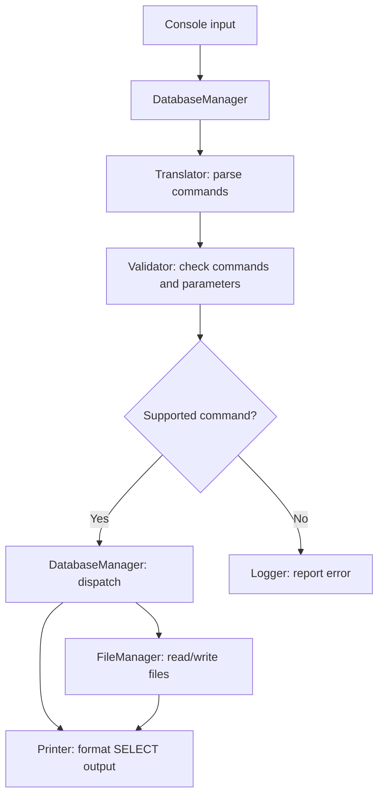
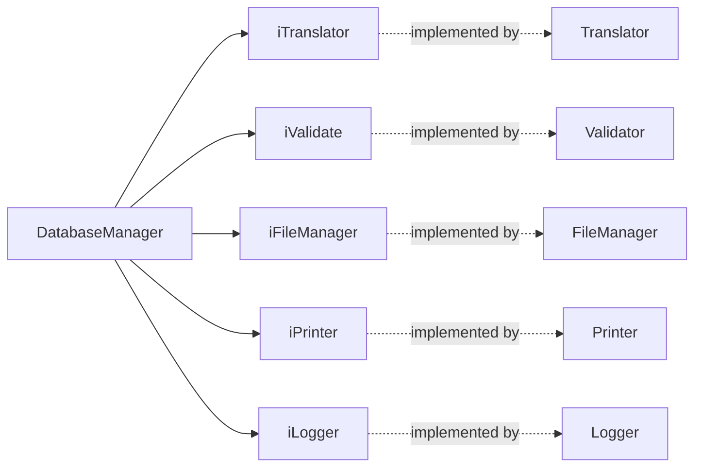

<div align="center">

# ∞ InfinityCodeLabs

### A tiny database engine, built from scratch in C++

**A command parser · File-backed storage · Interface-driven design**


*What happens if you try to build a database instead of using one?*

</div>

---

## About

**InfinityCodeLabs** is my experiment in building a small, SQL-inspired database engine in C++. Rather than connecting to an existing database, the project implements its own command processing, validation, file operations and output formatting.

It's a learning project, not a replacement for SQLite or a full SQL implementation. The interesting part is the code behind each command: how text becomes a structured operation, how invalid input is handled and how the components communicate through interfaces.

## How it works



The diagram is a simplified overview of the processing pipeline; the actual implementation also performs validation at multiple stages.

## Commands

The command dispatcher in `DatabaseManager.cpp` recognizes these operations:

| Command | What the implementation does |
|:--|:--|
| `CREATE` | Creates a table-backed file and writes field information. |
| `INSERT INTO` | Validates supplied values against the table fields and appends a record. |
| `SELECT` | Reads records and prints all fields (`*`) or selected fields. |
| `DELETE FROM` | Clears the records in a table. |
| `DROP` | Deletes the table file. |

> **Limitations:** This is a small SQL-like command language, not a complete SQL parser. `WHERE` clauses are explicitly marked unsupported in the current `SELECT` and `DELETE FROM` paths. Do not use this project for production data.

## Inside the code



| Location | Responsibility |
|:--|:--|
| [`main.cpp`](main.cpp) | Constructs the helpers and starts the console loop. |
| [`DatabaseManager.cpp`](DatabaseManager.cpp) | Coordinates parsing, validation and execution. |
| [`Helper/`](Helper/) | Concrete implementations of translation, validation, file access, logging and printing. |
| [`Interface/`](Interface/) | Interfaces used to decouple the manager from concrete helpers. |
| [`Utils/`](Utils/) | Shared command, error and type definitions. |
| [`DB_Damian_Panasiuk.pro`](DB_Damian_Panasiuk.pro) | qmake project configuration for a C++11 console application. |
| [`Doxyfile`](Doxyfile) | Doxygen configuration. |

## Build and run

The repository includes a **qmake** project file. Although it uses qmake, the `.pro` file explicitly disables the Qt framework dependency (`CONFIG -= qt`).

You need a C++11 compiler, `qmake` and `make`.

```bash
git clone https://github.com/GHRik/InfinityCodeLabs.git
cd InfinityCodeLabs
mkdir build && cd build
qmake ../DB_Damian_Panasiuk.pro
make
```

Run the generated executable (typically `DB_Damian_Panasiuk` on Linux):

```bash
./DB_Damian_Panasiuk
```

The program reads commands from standard input in a loop. Press **Ctrl+C** to exit. The exact input grammar is defined by the translator and validator; the command names above are not a guarantee of full SQL syntax compatibility.

## What I'd improve next

- Add a documented command grammar with copy-pasteable examples and expected output.
- Add automated tests for the parser, validation and file storage.
- Handle invalid commands without modifying vectors while iterating forward.
- Add support for filtered queries (`WHERE`) and more informative errors.
- Replace the infinite input loop with a clean `EXIT` command and EOF handling.
- Add a CI build to catch regressions.

## Why I built it

I wanted to understand what happens *inside* a database-like program, not just how to send queries to one. Building a parser, a dispatcher and a storage layer was a practical way to explore C++ design, interfaces and error handling.

---

<div align="center">

Made by **[Damian Panasiuk](https://github.com/GHRik)** · [View source](https://github.com/GHRik/InfinityCodeLabs)

</div>
